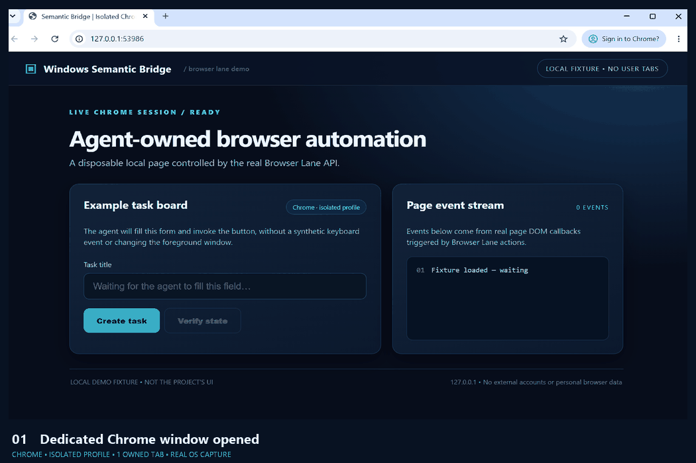

# Windows Semantic Bridge

  [](LICENSE)  [CI](.github/workflows/windows-tests.yml)

**Windows accessibility observation and focus-preserving agent browser control.**

Experimental, Windows-only companion for MCP-based desktop automation. The source includes a read-only UI Automation observer, a fail-closed semantic action planner, an isolated headless Chrome controller, and a Chrome Manifest V3 extension for agent-owned background tabs.

The project is independently packaged; it does **not** redistribute or replace [Windows MCP Server](https://github.com/deploymenttheory/windows-mcp-server). An actual desktop action must still be validated and authorized by an external Windows MCP executor.

## Watch it work — real Chrome window



**A real Chrome window, not a mockup:** the GIF includes Chrome's actual **tab strip and address bar**, captured from a dedicated Chrome process with a fresh temporary profile. The local page is a disposable test fixture; it is **not the product's GUI**. Every interaction is performed by this repository's `BrowserLane` implementation, using owned tabs only: fill a field, invoke buttons, verify DOM state, open a second browser tab, navigate it, and close it.

> Recording the browser **window chrome** (rather than only webpage content) requires temporarily displaying this isolated Chrome window in the foreground. The capture script restores the previous foreground application when finished and refuses to save frames if a different window becomes active. **This video demonstrates browser automation, not a no-focus-stealing benchmark.** Browser Lane itself performs actions through CDP without synthetic mouse/keyboard input.

[View a full-size browser screenshot](assets/demo-browser-lane.png) · [Reproduce the capture](scripts/record_browser_demo.py)

To regenerate the GIF on Windows after installing the development requirements:

```powershell
.\.venv\Scripts\python.exe scripts\record_browser_demo.py
```

The recorder operates only on a local HTTP fixture at `127.0.0.1`, creates an isolated Chrome user-data directory, saves a GIF and still image, closes its own Chrome process, and disposes of the temporary profile. Its screen capture is restricted to the browser window interior and checked against the exact temporary Chrome window identity to avoid personal desktop content.
## Why it exists

Coordinate-based GUI agents constantly capture screens, infer click locations, and steal focus. Semantic Bridge explores a different split: the observer reports accessibility elements and deltas; the planner targets explicit unique elements; and the existing authorized executor performs desktop actions only after rechecking the current state. Browser Lane uses only agent-owned tabs, not the user's open tabs.

## Features

- Read-only Windows accessibility snapshots and bounded semantic deltas
- On-demand observation with PID identity checks, reconciliation and stop/reset
- Deterministic semantic plans with revision, role, capability and ambiguity checks
- Optional authenticated named-pipe observer; no public network listener or autostart
- Isolated headless Chrome profile, with agent-owned tab operations via CDP
- Optional Chrome MV3 background tab group, using a local native messaging host
- Unit and integration tests; Windows GUI/Chrome prerequisites for live tests

## Prerequisites

Windows 11, Python 3.12+, Chrome for browser features, and a compatible external **Munim Computer Use** executable for Windows accessibility data. The Munim executable is deliberately **not included**. This code is not a substitute for an independently authorized Windows MCP executor.

## Quick start

From PowerShell, in a fresh clone:

```powershell
py -3.12 -m venv .venv
.\.venv\Scripts\python.exe -m pip install -r requirements-dev.txt
.\.venv\Scripts\python.exe -m pytest -q tests browser_lane/tests
```

Read-only MCP observer via stdio (after obtaining and independently verifying Munim):

```powershell
$env:SEMANTIC_BRIDGE_MUNIM_EXE = "C:\path\to\munim-computer-use.exe"
.\.venv\Scripts\python.exe server.py
```

The MCP client may call `lab_watch_pid`, `lab_watch_foreground`, `lab_poll`, `lab_delta_since`, `lab_snapshot`, `lab_stop`, and explicit visual fallback `lab_capture_window`. The server exposes **no desktop input tools**.

An independent, headless browser profile can be started without the extension:

```powershell
.\.venv\Scripts\python.exe browser_lane\browser_cli.py start
.\.venv\Scripts\python.exe browser_lane\browser_cli.py new https://example.org
.\.venv\Scripts\python.exe browser_lane\browser_cli.py list
.\.venv\Scripts\python.exe browser_lane\browser_cli.py shutdown
```

## Chrome extension

Optional source: `browser_lane/extension/`. The extension's `nativeMessaging` bridge requires compiling `native_host_proxy.cs` locally, installing a native host manifest on Windows, and setting its `allowed_origins` to **your own** Chrome extension ID. No compiled proxy or fixed extension key is distributed. The Chrome extension is not enabled by default. The experimental MV3 path should not be treated as universally compatible without local testing.

## Security limitations

- Only grant access to trusted MCP clients. UI accessibility trees may reveal confidential visible text.
- Browser Lane creates and tracks its own tabs; it must not attach to ordinary user tabs.
- Native messaging uses a fixed command set and bounded payloads, not arbitrary shell commands.
- Generated Chrome profiles, sessions, binaries, tokens, logs and local machine configuration are ignored by Git.
- This project does not bypass OS, browser, or application permissions. It cannot protect against a malicious process running with the same user's authority.
- Never connect it to accounts or data without authorization.

## Upstream and attribution

[deploymenttheory/windows-mcp-server](https://github.com/deploymenttheory/windows-mcp-server) is a separate MIT-licensed project. It is not vendored or modified in this repository. The included Python code is published independently under MIT (see LICENSE). Munim and Chrome are separately installed third-party dependencies, not bundled assets.

Bug reports and pull requests are welcome. Please exclude private screenshots, access tokens, hostnames, personal files and runtime session data.
